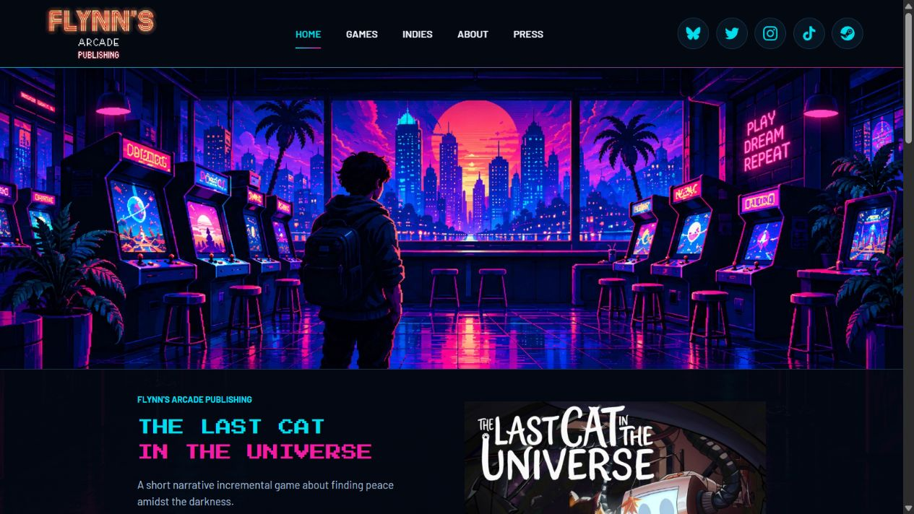

# Flynn's Arcade para Elementor

Esta carpeta es un **plugin**, no un tema. Permite conservar Elementor y el tema que ya tienes activo. Incluye las cinco secciones, las 32 fichas, los 18 estudios, las imagenes, las animaciones, los filtros y los materiales de prensa de la version neon.

## Sustituir el Home antiguo

1. Haz una copia de seguridad y comienza en una copia de prueba de tu web.
2. Instala esta carpeta completa como plugin: comprime **Elementor/** en ZIP y utiliza **Plugins > Anadir nuevo > Subir plugin**. Tambien puedes subirla por el gestor de archivos a `wp-content/plugins/flynns-arcade-elementor/`.
3. Activa **Flynn's Arcade for Elementor**. No cambies el tema ni desactives Elementor. No necesitas Elementor Pro.
4. Duplica tu Home actual. Abre la copia con **Editar con Elementor**.
5. En esa copia, elimina las secciones antiguas que quieras sustituir. No pegues el nuevo codigo debajo del contenido antiguo, porque se veria duplicado.
6. Selecciona la estructura de pagina **Elementor Canvas** si quieres la cabecera y el pie neon incluidos en este plugin. Esto solo afecta a esa pagina, no cambia el tema de la web.
7. Anade un contenedor de ancho completo, sin separacion ni relleno, y dentro el widget **Shortcode / Codigo corto**.
8. En el campo de ese widget, escribe unicamente:

```text
[flynns_home]
```

9. Guarda y abre la vista previa. Comprueba los enlaces y el movil antes de sustituir tu Home real o seleccionarlo como portada en Ajustes > Lectura.

No pegues archivos PHP, documentos HTML completos ni los archivos CSS o JavaScript en el editor de texto. El shortcode carga todo automaticamente. Tampoco se inserta como texto en un widget de encabezado.

## Otras paginas

Utiliza un widget Shortcode por pagina, siguiendo los mismos pasos:

| Pagina | Contenido del widget |
| --- | --- |
| Home | `[flynns_home]` |
| Games | `[flynns_games]` |
| Indies | `[flynns_indies]` |
| About | `[flynns_about]` |
| Press | `[flynns_press]` |
| Una ficha | `[flynns_game slug="what-comes-after"]` |

Cada seccion tiene una carpeta **Elementor/** con su codigo. Cada juego tiene tambien su propio **Elementor/shortcode.txt**. Conserva las URLs publicas que ya utilizan tus paginas cuando sustituyas su contenido.

El menu busca paginas publicadas que contienen estos shortcodes, tanto en el editor normal como en los datos de Elementor. Si hay dos Home publicados con el mismo shortcode, utiliza el de menor ID; para evitar ambiguedad, manten la copia nueva como borrador hasta sustituir la original. No cambies una URL de produccion sin preparar su redireccion.

Mientras conviertes las fichas, Games puede abrirlas mediante un parametro `flynns_game`. Para tener URLs independientes y el titulo propio de cada juego, coloca el shortcode del juego en su pagina existente: los enlaces del plugin la detectaran. Si utilizas un plugin de cache de paginas, excluye los parametros `flynns_game` y `flynns_section` durante esa transicion.

## Conservar tu cabecera y tu pie actuales

Si prefieres utilizar la cabecera y el pie de tu tema o de Elementor, selecciona la estructura de pagina adecuada para ellos y utiliza:

```text
[flynns_home chrome="no"]
```

La misma opcion funciona con Games, Indies, About, Press y las fichas. No combines una cabecera del tema con la cabecera incluida en el plugin si no quieres dos menus.

## Que sigue siendo editable

Puedes mover el widget, cambiar el ancho del contenedor y rodearlo de otros widgets de Elementor. La maquetacion interna neon no se convierte en cientos de widgets: sigue en los archivos PHP, CSS y JavaScript de esta carpeta. El contenido de las plantillas se edita en esos archivos. Los JSON conservan el inventario de referencia; el catalogo identifica las fichas.

Los estilos estan limitados a `.flynns-arcade`; no cambian los colores, las fuentes ni los botones de otros widgets. Las interacciones se inicializan tambien cuando Elementor vuelve a renderizar el widget. Los identificadores de galerias, iconos y navegacion tienen un prefijo propio.

## Organizacion

```text
Elementor/
  flynns-arcade-elementor.php   Entrada del plugin
  HOME/                       PHP, CSS, JavaScript, JSON, Images y Elementor
  GAMES/                      Catalogo y Juegos/<nombre>/
  INDIES/                     Directorio y Estudios/<nombre>/
  ABOUT/                      Historia, fotos y proyectos
  PRESS/                      Cobertura y presskits
  COMPARTIDO/                 Estilos aislados, funciones, fuentes e iconos
  README.md                   Esta guia
```

El plugin no crea, elimina ni sobrescribe paginas, usuarios o menus. No cambia el tema activo ni instala otros plugins. La newsletter conserva su aviso de proxima apertura y no simula suscripciones reales. No se ha publicado nada en tu web real.

Requisitos minimos: WordPress 6.3 y PHP 7.4 para el complemento; utiliza tambien versiones compatibles con el Elementor instalado en tu sitio. El codigo mantiene licencia GPL-2.0-or-later. Los materiales de terceros mantienen sus derechos y licencias.

Documentacion oficial: [widget Shortcode](https://elementor.com/help/shortcode-widget/) y [estructura Canvas](https://elementor.com/help/using-elementors-canvas-page-template/).

## Verificacion

- Probado en WordPress 7.1.3, Elementor gratuito 4.3.5 y Hello Elementor, con PHP 8.3.36.
- Las 37 paginas se han renderizado mediante widgets Shortcode reales de Elementor, conservando todo el texto de la web actual.
- Comprobados 342 recursos enlazados, identificadores accesibles, rutas de fichas y parametros invalidos.
- Busqueda, animacion al enfocar tarjetas, pausa de animaciones y galeria ampliada comprobadas.
- Las cinco secciones y una ficha se han revisado en movil sin desbordamiento horizontal.
- Los botones externos mantienen color, fondo, tipografia y separacion. Una pagina normal sin shortcode no carga recursos del plugin.
- La carga progresiva sigue funcionando tras reemplazar el contenido del widget en una prueba de actualizacion de vista previa.
- Los 464 archivos de la web HTML original permanecen sin cambios.

La integracion se ha probado en una instalacion local independiente. No se ha instalado en tu WordPress real ni se han probado todos los posibles temas o plugins de terceros.


